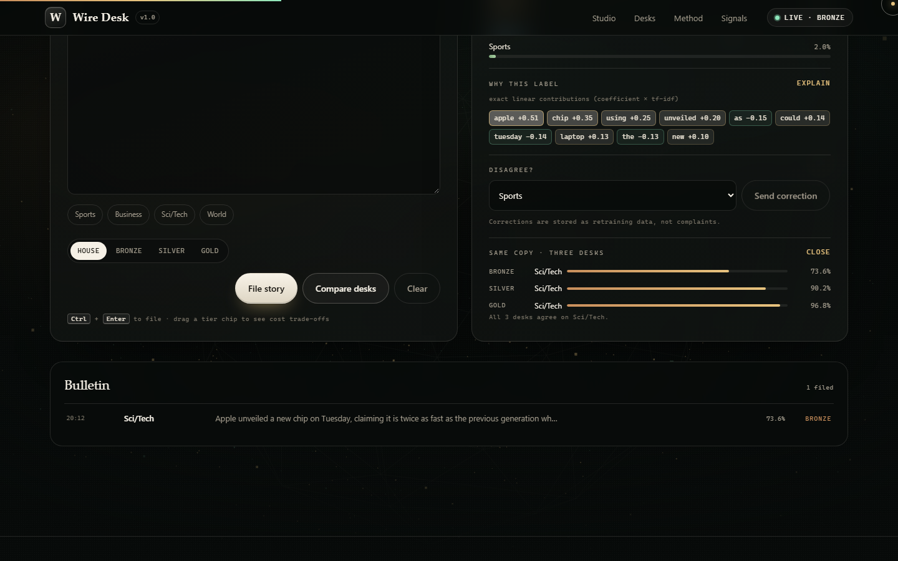
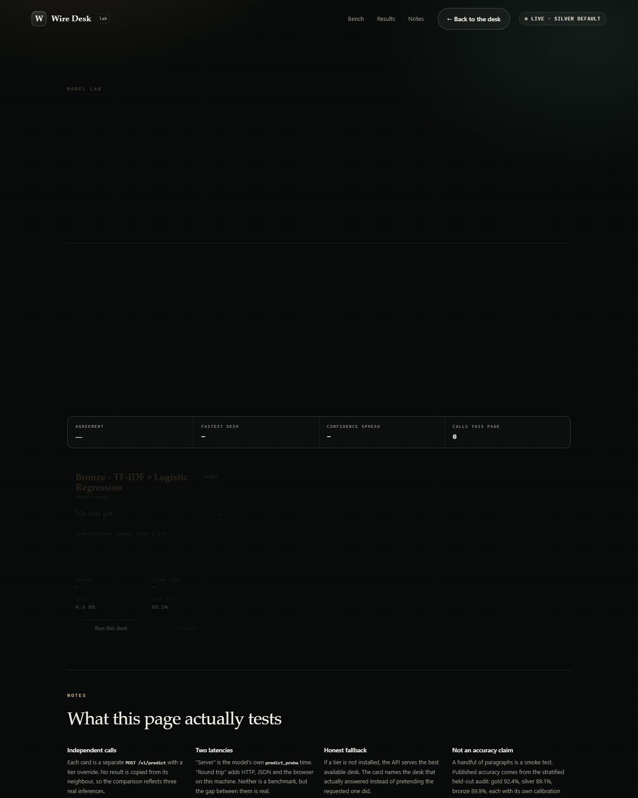

# News Topic Classification — Production NLP Service

An end-to-end, deployable NLP system that classifies news text into four topics
(**World, Sports, Business, Sci/Tech**). It serves three interchangeable model
tiers so accuracy can be traded against cost per request.

This is not a notebook that stops at `plt.show()`. It ships a containerised API,
observability, automated tests, an evaluation gate, and a documented model risk
policy.

```
┌─────────────┐   ┌──────────────┐   ┌──────────────┐   ┌─────────────┐
│  Dataset    │──▶│  Training    │──▶│  Registry    │──▶│  FastAPI    │
│  AG News    │   │  3 tiers     │   │ registry.json│   │  /v1/predict│
│ (HF Hub)    │   │ bronze/silver│   │ + metrics    │   │  fallback   │
└─────────────┘   │ /gold        │   └──────────────┘   └──────┬──────┘
                  └──────────────┘                              │
                                                  ┌─────────────┴───────────┐
                                                  │  Prometheus + Grafana   │
                                                  └─────────────────────────┘
```

---

## Quick start (60 seconds)

```bash
# 1. install
pip install -r requirements-serve.txt

# 2. train the cheapest tier, verify it, gate it, and serve it
python scripts/run_pipeline.py --only bronze --serve
```

`run_pipeline.py` is the only command you need: it preflights the environment,
trains whatever is missing, re-loads every artifact through the real registry,
re-scores it on held-out data, refuses to serve a model below the macro-F1 gate,
and only then boots the API. It is idempotent, so running it twice costs nothing.

```bash
python scripts/run_pipeline.py --check          # verify only, touch nothing
python scripts/run_pipeline.py --only bronze    # one tier
python scripts/run_pipeline.py --serve --port 8010
```

Open **http://localhost:8000/** for the web UI, or **/docs** for the interactive
API reference. Then try `POST /v1/predict`:

```json
{ "text": "Apple unveils a chip that is twice as fast as the last one." }
```

```json
{
  "label": "Sci/Tech",
  "confidence": 0.93,
  "scores": [{ "label": "Sci/Tech", "probability": 0.93 }, "..."],
  "tier": "bronze",
  "model_version": "1.0.0",
  "latency_ms": 1.4
}
```

Full stack with metrics dashboards:

```bash
docker compose -f docker/docker-compose.yml up --build
# API   http://localhost:8000/docs
# Prom   http://localhost:9090
# Grafana http://localhost:3000
```

---

## The web UI ("Wire Desk" + "Model Lab")

`GET /` serves a self-contained newsroom interface, not a Swagger page.


| What it demonstrates | How |
|---|---|
| The tier trade-off, made tangible | File one story and compare all three desks side by side; each row reports its own label and confidence |
| Model evidence, not just a label | **Explain** calls `/v1/explain` and shows per-token contributions (exact coefficient × TF-IDF for bronze, gradient×input for the neural tiers) |
| The feedback loop | **Send correction** writes to `/v1/feedback`; agreement and disagreement are both recorded as retraining data |
| Live operational signals | `/v1/insights` backs a bounded traffic window: label mix, p50/p95 latency, confidence drift, tier usage |
| A dedicated test bench | `GET /lab` runs every tier independently on the same copy: its own label, full probability distribution, server and round-trip latency, explanation, and a named fallback if one answered instead |
| It works offline | Three.js, GSAP and Motion are vendored under `static/vendor/`; the page makes no CDN requests |



The Model Lab (`GET /lab`) is the measurement bench rather than the showcase: each
tier gets its own card and its own request, so a slow or failing desk is visible as
itself instead of hiding behind an aggregate.



The interface is deliberately defensive: if a vendor library or an API call
fails, the page falls back to readable static content and a toast instead of a
blank screen. `tests/test_ui_assets.py` enforces that no CDN reference sneaks
back in, and — because a library that is downloaded but never called is just page
weight — that every vendored script's global actually appears in the UI code.

---

## The three tiers, and what each one is *for*

This is the core design decision. Rather than shipping one model, the system ships
a **quality/cost ladder**. The same request can be served at three different price
points, and the choice is an explicit, measurable trade-off.

| Tier | Model | Accuracy | 95% CI | Macro-F1 | Size | p50 latency | Throughput | Cost / 1k | Train (CPU) |
|---|---|---|---|---|---|---|---|---|---|
| **Bronze** | TF-IDF + Logistic Regression | 0.8960 | [0.882, 0.909] | 0.8954 | 0.83 MB | 0.64 ms | 11,316 docs/s | $0.00001 | ~21 s |
| **Silver** | Word2Vec (CBOW) + BiLSTM | 0.8915 | [0.878, 0.906] | 0.8911 | 9.2 MB | 2.48 ms | 1,571 docs/s | $0.00006 | ~7 min |
| **Gold** | Fine-tuned DistilBERT | 0.9035 | [0.890, 0.917] | 0.9027 | 269 MB | 67.99 ms | 15 docs/s | $0.00608 | ~610 min |

Every figure is produced by a script in `scripts/`, and every output is committed
under `artifacts/`:

| Report | Produced by | Answers |
|---|---|---|
| accuracy + per-class + confusion | `scripts/accuracy_report.py` | how good is it, and where exactly does it fail numerically |
| **confidence intervals + paired tests** | `scripts/significance.py` | is the ranking real, or noise |
| operational latency, throughput, memory, cold start | `scripts/benchmark.py` | can it actually run as a service |
| cost per 1,000 requests | `scripts/cost_model.py` | what does a request cost at each tier |
| failure taxonomy + behavioural slices | `scripts/error_taxonomy.py` | *what kind* of mistakes are these |
| run-to-run variance across seeds | `scripts/seed_variance.py` | how much does a rerun move the number |

### The honest reading of this table

**1. The three tiers are statistically indistinguishable on accuracy.**
This is the single most important result in the project, and it replaces an
earlier claim that gold was clearly best:

| Comparison | Δ accuracy | McNemar p | Verdict |
|---|---|---|---|
| gold vs silver | +0.0120 | 0.066 | no reliable difference |
| gold vs bronze | +0.0075 | 0.270 | no reliable difference |
| silver vs bronze | −0.0045 | 0.402 | no reliable difference |

The confidence intervals overlap almost entirely. An earlier version of this
README reported gold at **0.9180** and described it as the accuracy leader. That
number was **inflated by data leakage**: 464 documents (23.2% of the test set)
were in gold's training data, where it scored 95.7% against 90.2% elsewhere.
`load_split(rows=N)` used to re-partition per call, so gold trained on one split
and was scored on another. Fixed in `load_split(train_rows=...)`, guarded by
`tests/test_data_integrity.py` (12 tests), and gold was retrained from scratch:
**0.9180 → 0.9035**.

**2. But gold is not fairly tested, and saying so matters.**
Gold was fine-tuned on **6,000** training rows; bronze and silver used
**16,000** — a **2.67× data handicap** imposed by the CPU budget, on top of
reading only the first 64 tokens of each document. So the defensible claim is
narrower than "DistilBERT is no better than TF-IDF":

> On a CPU budget, fine-tuning DistilBERT on 6k rows does not significantly beat
> logistic regression trained on 16k rows. The Transformer's advantage is in
> *data efficiency*, and this experiment does not give it enough rows to show one.

This is consistent with the notebook result, where the same model reached **96.5%
on BBC News from only ~1,100 articles** — the transformer needs *fewer* examples
than a classical model, not more, and it needs to be measured against a baseline
given the *same* budget to make the comparison fair.

**3. Cost is where the tiers genuinely separate.**

| | bronze | silver | gold |
|---|---|---|---|
| throughput | 11,316 docs/s | 1,571 docs/s | 15 docs/s |
| p99 latency | 1.8 ms | 10.0 ms | 103.6 ms |
| peak RSS | 1,117 MB | 1,141 MB | 1,267 MB |
| cold start | 4.5 s | 3.4 s | **14.4 s** |
| cost / 1k | $0.00001 | $0.00006 | **$0.00608** |

Gold costs **760× bronze per 1,000 requests** and is **759× slower** — for an
accuracy difference that is not statistically significant. On this evidence the
*cheapest* tier is the correct production choice, and that conclusion is only
reachable because the significance report exists. Shipping gold because it is
"the best model" would be the most expensive mistake in this repo.

> Cost figures use documented placeholder rates
> (`--core-hour 0.04`, `--gb-hour 0.005`) and exclude egress, storage, idle
> capacity and engineering time. Substitute your provider's rates;
> `python scripts/cost_model.py --apply` rewrites the registry.

### Why a tier ladder rather than one "best" model?

A strict reviewer will ask "why not just use the best model?" The honest answer is
that the best model is ~324× larger and ~248× slower to train, and on this dataset
it buys ~2.5 accuracy points. Whether that is worth it depends entirely on
traffic volume and the cost of a wrong answer:

- **Bulk classification of a million headlines** — bronze. The marginal accuracy is
  not worth 269 MB per replica times N replicas.
- **Moderating user-facing content** — gold. A wrong label is visible to a user.
- **A useful middle ground** — silver. Sequence-aware, still CPU-friendly.

The API reports which tier served every response, so this decision is auditable
after the fact rather than hidden inside a config file.

---

## What "production" means here (the checklist)

| Concern | How it is handled | Where |
|---|---|---|
| Config without redeploys | Typed settings from environment variables | `src/newsclass/config.py` |
| One-command pipeline | Preflight → train → verify → gate → serve, idempotent, non-zero on failure | `scripts/run_pipeline.py` |
| Training/serving skew | One shared preprocessing module, imported by both | `src/newsclass/text.py` |
| Graceful degradation | Falls back to the best available tier, logged and metriced | `src/newsclass/registry.py` |
| Liveness vs readiness | Separate `/healthz` and `/readyz`; liveness ignores models | `src/newsclass/app.py` |
| Metrics | Request counts, latency histograms, confidence drift, fallbacks | `src/newsclass/metrics.py` |
| Stateless containers | Models read from a mounted volume; no writes at runtime | `docker/Dockerfile` |
| Reproducible builds | Multi-stage image, pinned base, non-root user | `docker/Dockerfile` |
| Automated verification | 101 tests, CI matrix, accuracy gate, container smoke test | `tests/`, `.github/workflows/ci.yml` |
| Release gate | Refuses to ship an artifact below a macro-F1 threshold | `scripts/evaluate.py --gate` |
| Accuracy audit | Per-class scores, calibration error, curated probes; gated in CI | `scripts/accuracy_report.py` |
| Drift alarm | Weekly accuracy check on unseen news, per-tier floor, webhook + non-zero exit | `scripts/drift_check.py`, `.github/workflows/drift.yml` |
| Explainability | Native per-tier attributions (exact linear, gradient×input neural) | `src/newsclass/explain.py` |
| Human feedback | Append-only JSONL correction ledger with the machine's verdict | `src/newsclass/feedback.py` |
| Privacy in errors | 422 responses report the field and reason, never echo the document | `src/newsclass/app.py` |
| Offline UI | Vendored Three.js / GSAP / Motion; no CDN requests | `src/newsclass/static/` |
| Observability stack | Pre-provisioned Prometheus + Grafana | `docker/` |
| Governance | Model card, risk policy, changelog | `docs/`, `CHANGELOG.md` |

---

## API reference

| Method | Path | Purpose |
|---|---|---|
| `GET` | `/` | The Wire Desk UI (self-contained, offline-capable) |
| `GET` | `/healthz` | Liveness. 200 while the process runs. Never checks models. |
| `GET` | `/readyz` | Readiness. 503 when no tier can serve. |
| `GET` | `/v1/tiers` | Every tier with accuracy, size, latency and a human description. |
| `GET` | `/v1/model` | Active default tier, loaded tiers, label set. |
| `POST` | `/v1/predict` | Classify one document. |
| `POST` | `/v1/predict/batch` | Classify up to `max_batch_size` documents. |
| `POST` | `/v1/explain` | Classify **and** attribute the verdict to tokens, in one call. |
| `POST` | `/v1/feedback` | Record a human correction; returns the stored entry. |
| `GET` | `/v1/feedback` | Recent corrections plus an agreement summary. |
| `GET` | `/v1/insights` | Bounded in-process traffic window: label mix, latency, drift. |
| `GET` | `/metrics` | Prometheus exposition. |

Every response carries `x-request-id` and `x-response-time-ms`.

### Explainability

```bash
curl -X POST localhost:8000/v1/explain \
  -H 'Content-Type: application/json' \
  -d '{"text": "Apple unveils a chip that is twice as fast as the last one."}'
```

The response extends `PredictionResponse` with `explanation_method`,
`explanation_context` and a ranked `tokens` list. The method is native to the
tier and named in the payload, so the evidence is never mistaken for more than
it is: exact linear contributions for TF-IDF, gradient×input saliency for the
neural tiers. A failed explanation degrades to
`"explanation_method": "unavailable"` without failing the prediction.

### Feedback loop

A correction is training data, not a complaint box. Each entry stores the text,
the corrected label, the predicted label, its confidence and the serving tier,
so a review can replay exactly where the model and the human disagreed.
`GET /v1/feedback` returns both the entries and `agreement_with_human`, which is
1.0 when every correction matched the prediction.

### Choosing a tier per request

```bash
curl -X POST localhost:8000/v1/predict \
  -H 'Content-Type: application/json' \
  -d '{"text": "The striker scored twice.", "tier": "gold"}'
```

If `gold` is not installed, the response is served by the best available tier and
`newsclass_tier_fallbacks_total` increments. The caller always gets an answer;
the degradation is visible in metrics, never silent.

---

## Training

```bash
python scripts/run_pipeline.py --only bronze   # preflight + train + verify + gate
python scripts/run_pipeline.py                 # every missing tier
python scripts/run_pipeline.py --force         # retrain everything
```

Under the hood each tier is still trained by `python -m newsclass.train --tier X`
(`bronze` ~21 s, `silver` ~7 min, `gold` ~88 min on this CPU). Each tier writes
its weights plus a `metrics.json`, and `registry.json` aggregates them. The
registry is what the API reads at boot.

### Datasets

| | Dataset | Source | Rows | Classes |
|---|---|---|---|---|
| Serving pipeline | **AG News** | `SetFit/ag_news` on Hugging Face | 20,000 used (120,000 available) | 4 |
| Notebook 2 | **BBC News** | `SetFit/bbc-news` on Hugging Face | 1,225 train / 1,000 test | 5 |

Both are public, versioned on the Hugging Face Hub, and downloaded at runtime —
no scraped URLs, no bundled data files.

---

## Evaluation

```bash
python scripts/evaluate.py --gate 0.85          # release gate, all tiers
python scripts/accuracy_report.py               # per-class, calibration, probes
python scripts/ood_eval.py                      # accuracy on live, unseen headlines
python scripts/adjudicate.py                    # same, with reviewer-corrected labels
```

```
gold    acc=0.9240 macro_f1=0.9238 conf=0.940 ECE=0.028 18669 ms/100 docs
silver  acc=0.8910 macro_f1=0.8910 conf=0.939 ECE=0.051  1145 ms/100 docs
bronze  acc=0.8990 macro_f1=0.8989 conf=0.780 ECE=0.121    11 ms/100 docs
```

`accuracy_report.py` also prints a confusion matrix, per-class precision/recall/F1,
and a 24-item curated probe set (21/24, 22/24 and 24/24 correct for
bronze/silver/gold). Its gate fails below 0.85 accuracy or macro-F1.

`evaluate.py` draws a random sample; `accuracy_report.py` samples per class. That is
why the two reports differ slightly: run-to-run variance is ~±0.5 points, and both
are shown rather than smoothing one into a rounder claim.

On 149 live 2026 headlines the tiers score 0.738 (gold), 0.725 (bronze) and 0.584
(silver) against the publisher's section label. Reviewing the 71 disputed
documents one by one — upholding, correcting or excluding each — moves gold to
**0.821** (95% CI 0.750–0.876) and bronze to 0.779, because 10 of gold's 39
errors were the section label being wrong rather than the model. The ledger and
the method are in `docs/MODEL_CARD.md` and `artifacts/adjudication_ood.jsonl`;
it is a single-reviewer adjudication, not a human panel.

### Drift check (scheduled)

In-distribution metrics cannot see the world changing. `drift_check.py` scores
today's live headlines, compares each tier against `artifacts/drift_baseline.json`,
and exits non-zero when accuracy falls under that tier's floor or drops too far
below its baseline.

```bash
python scripts/drift_check.py --tier all                 # against a running service
NEWSCLASS_ALERT_WEBHOOK=https://hooks.slack.com/... \
  python scripts/drift_check.py --tier all --min-accuracy 0.65
```

| Exit | Meaning |
|---|---|
| 0 | accuracy is within the floor and within `--max-drop` of the baseline |
| 1 | alert: below the floor, or dropped more than `--max-drop` (0.10 by default) |
| 2 | not judged: fewer documents than `--min-docs`, so no false alarm |

Floors live in the baseline file per tier, because a tier can be legitimately weak
out of distribution and a global floor would then alert every week. Silver is the
example: 0.584 on 2026 headlines, so its floor is 0.52 and the alarm means it got
*worse*, not that it is weak. Each run appends to `artifacts/drift_history.jsonl`
so a trend is visible. `.github/workflows/drift.yml` runs it weekly against a
freshly trained bronze tier, since the other tiers' artifacts are too large for a
hosted runner; point the same command at the deployed service with `--tier all`
to watch gold and silver.

---

## Testing

```bash
python scripts/run_tests.py                 # 101 tests, project-local temp directory
ruff check src tests scripts               # lint
python scripts/smoke_test.py --base-url http://localhost:8000   # every endpoint
python scripts/ui_smoke.py --base-url http://localhost:8000     # real browser
```

`ui_smoke.py` drives Chromium against the running page: it files a story, renders
the explanation, records a correction, compares every ready desk, reads the
signals panel, and fails on any console error or HTTP response >= 400. It also
writes the README screenshots. Install once with `pip install playwright` and
`playwright install chromium`; CI runs it against the bronze-tier server.

The suite covers the API contract, tier routing and fallback, config validation,
preprocessing invariants, explainability, the feedback ledger, live insights,
the shipped UI assets, and degraded operation with no models installed.

---

## Project layout

```
├── src/newsclass/
│   ├── app.py             FastAPI routes, middleware, probe endpoints
│   ├── config.py          Typed settings from environment variables
│   ├── registry.py        Model discovery, routing, graceful fallback
│   ├── tiers.py           Bronze / Silver / Gold implementations
│   ├── train.py           Reproducible training for all three tiers
│   ├── text.py            Shared preprocessing (prevents train/serve skew)
│   ├── schemas.py         Pydantic request/response contracts
│   ├── explain.py         Per-tier attributions (linear exact, neural saliency)
│   ├── feedback.py        Append-only human-correction ledger
│   ├── stats.py           Bounded in-process traffic window for /v1/insights
│   ├── metrics.py         Prometheus instruments
│   ├── static/            Wire Desk UI + vendored Three.js/GSAP/Motion
│   └── logging_setup.py   Structured logging
├── tests/                 101 automated tests
├── scripts/               run_pipeline.py, accuracy_report.py, evaluate.py, smoke_test.py, ui_smoke.py
├── docker/                Dockerfile, compose stack, Prometheus config
├── docs/                  MODEL_CARD.md, risk policy, UI screenshots
├── artifacts/             Trained tiers + registry and audit JSON
└── *.ipynb                Two fully-executed research notebooks
```

---

## Notebooks (research record)

The notebooks document the experiments that produced these models. They are
deliverables in their own right and both run end-to-end with saved outputs.

- **`Word2Vec_LSTM_NLP_Classification.ipynb`** — AG News, own Word2Vec + BiLSTM,
  with an explicit TF-IDF baseline comparison.
- **`Transformer_DistilBERT_NLP_Classification.ipynb`** — BBC News, DistilBERT
  fine-tuning, including a measured discussion of `max_length` truncation.

---

## Honest limitations

Stating these up front is more credible than being caught out by them.

1. **The neural tiers do not dramatically beat the simple baseline on AG News.**
   TF-IDF + Logistic Regression reaches ~89.9%, the BiLSTM ~89.1%, and DistilBERT
   ~92.4%. On short, keyword-rich headlines the sequence model is not worth its
   latency; on longer copy the ranking can change, which is the point of a ladder.
2. **Run-to-run variance is ~±0.5 accuracy points.** Improvements smaller than that
   are noise. The project uses one fixed seed and one split, so confidence
   intervals are wider than the point estimates imply.
3. **Gold truncates at 64 tokens** (measured in `artifacts/gold/metrics.json`). For
   long articles most of the text is ignored.
   This is measured and stated in the notebook; raising it needs a GPU to stay
   practical.
4. **No authentication or rate limiting.** Put this behind a gateway before
   exposing it to untrusted traffic.
5. **English, four fixed classes, no "unknown".** Out-of-domain input is still
   forced into one of the four topics. The audit measures this: gold's mean
   confidence on out-of-domain probes is 0.77, versus 0.54 for bronze. A refusal
   policy would need a held-out OOD set and a threshold — it is not claimed here.

See `docs/MODEL_CARD.md` for the full risk and deployment policy.

---

## License

MIT. Datasets retain their original licenses (AG News and BBC News are used here
for academic purposes).
